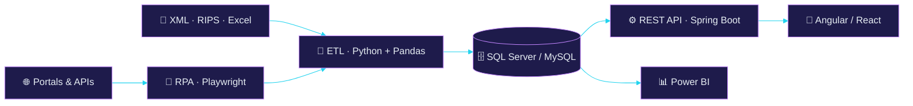

<div align="center">


<a href="https://git.io/typing-svg">
  
</a>

<br/>

[](https://zseuz.github.io/)
[](https://www.linkedin.com/in/jonathan-pava-ramirez/)
[](https://github.com/zseuz)
[](mailto:jonathanramir52@gmail.com)


</div>


##  Hi, I'm Jonathan

<table>
<tr>
<td width="55%" valign="top">

<a href="https://git.io/typing-svg"></a>

```yaml
profile:
  subject:   Jonathan Ramírez
  role:      Full Stack Developer & Data Analyst
  origin:    Bogotá, Colombia
  focus:     Backend · ETL/RPA · BI · Cloud
  toolchain: Spring Boot · Angular · Python
stack:
  backend:   Java · PHP · Node.js
  frontend:  Angular · React · Vue.js
  data:      Python · Pandas · Playwright
  bi:        Power BI · SQL Server · MySQL
  cloud:     Linux · Cron · Git
  ai:        Claude · OpenAI · Prompt Engineering
contact:
  linkedin:  /in/jonathan-pava-ramirez
  timezone:  UTC-5 · Bogotá
```

</td>
<td width="45%" valign="top">

Full Stack Developer and Data Analyst with **3+ years of experience** building:

- 🌐 Scalable web apps & backend architectures
- 🤖 Process automation (**RPA**) and **ETL** pipelines
- ☁️ Cloud infrastructure on Linux
- 📦 Large-scale data processing
- 🧠 Generative AI integrations

🏥 **Healthcare data** — RIPS, XML, CUV
💰 **Finance** — *cartera*

</td>
</tr>
</table>

<div align="center">

<table>
<tr>
<td align="center" width="260">

<h2>80%</h2>
<sub>less manual work with ETL & RPA</sub>
</td>
<td align="center" width="260">

<h2>50%</h2>
<sub>lower SQL query latency</sub>
</td>
<td align="center" width="260">

<h2>3+ years</h2>
<sub>building end-to-end solutions</sub>
</td>
</tr>
</table>

</div>

##  What I Build

<div align="center">
<table>
<tr>
<td width="33%" valign="top" align="center">

<h3>Backend & APIs</h3>

<p>RESTful APIs and transactional modules with <b>Spring Boot</b>, <b>Laravel</b> and <b>Node.js</b>, built on clean relational models.</p>
</td>
<td width="33%" valign="top" align="center">

<h3>Frontend</h3>

<p>Responsive, interactive interfaces with <b>Angular</b>, <b>React</b> and <b>Vue.js</b>, focused on usability and operational flow.</p>
</td>
<td width="33%" valign="top" align="center">

<h3>ETL & Automation</h3>

<p>RPA bots and ETL pipelines with <b>Python</b>, <b>Pandas</b> and <b>Playwright</b> for large-scale extraction and validation.</p>
</td>
</tr>
<tr>
<td width="33%" valign="top" align="center">

<h3>BI & SQL</h3>

<p><b>Power BI</b> dashboards, KPIs, dimensional modeling and tuned stored procedures on <b>SQL Server</b> and <b>MySQL</b>.</p>
</td>
<td width="33%" valign="top" align="center">

<h3>Cloud & Linux</h3>

<p>Linux cloud servers, scheduled jobs with <b>cron</b> and secure database management.</p>
</td>
<td width="33%" valign="top" align="center">

<h3>AI & LLMs</h3>


<p><b>Claude</b> and <b>OpenAI</b> integrations, prompt engineering and AI-driven development.</p>
</td>
</tr>
</table>
</div>

##  How my data flows



##  `./skills --radar`

<div align="center">
<table>
<tr>
<td></td>
<td></td>
</tr>
</table>
</div>

##  Tech Stack

<div align="center">


<br/>

<br/><br/>


</div>

##  GitHub Stats

<div align="center">


</div>

##  Contribution Snake

<div align="center">

<picture>
  <source media="(prefers-color-scheme: dark)" srcset="https://raw.githubusercontent.com/zseuz/zseuz/output/github-contribution-grid-snake-dark.svg" />
  <source media="(prefers-color-scheme: light)" srcset="https://raw.githubusercontent.com/zseuz/zseuz/output/github-contribution-grid-snake.svg" />
  
</picture>

</div>

<div align="center">

##  Let's connect

<a href="https://git.io/typing-svg"></a>

[](mailto:jonathanramir52@gmail.com)
[](mailto:jonathan.analista.datos.52@gmail.com)
[](https://www.linkedin.com/in/jonathan-pava-ramirez/)
[](https://zseuz.github.io/)


</div>
